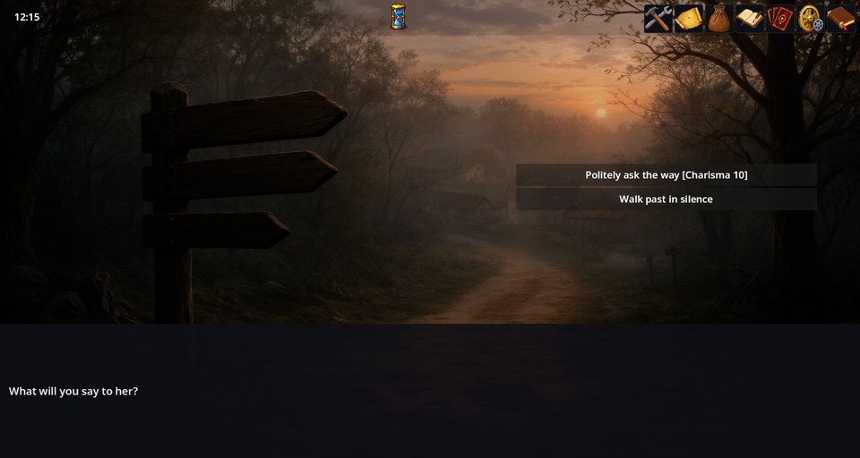
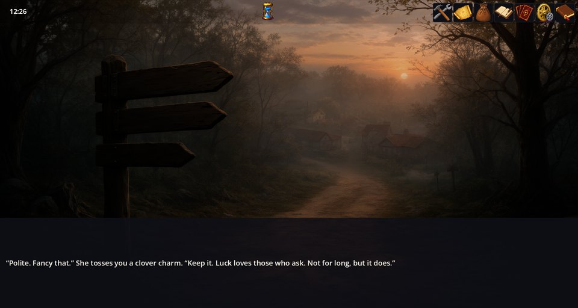

# Stat Checks — ステータス判定で難易度に挑む

Stat Checks はシナリオにコマンドをひとつ追加します。`check` です。キャラクターのステータスを取り、ダイスの出目とボーナスを加え、合計を難易度と比べて、成功か失敗かで物語を続けます。ビジュアルノベルなら門番を説得し、タイル RPG なら錆びた扉をこじ開けます。ステータスそのものは Stats Engine とゲームのルール（RPG Plus なら Classic RPG Rules）が担います。

## ゲームの中で

RPG Plus のプロローグでは、道が分かれる場所に旅の女が座っています。選択肢のひとつは、その判定——カリスマ対 10——を自ら告げます:



答えたあと、出目はひとつの行で示されます:


ここでの主人公はレベル 1 のローグでカリスマ 8。d20 は 3 が出たので、合計は 11 対 10——成功です。物語は成功の枝へ進み、女は主人公にお守りを投げてよこします。



合計が 10 に届かなければ、行は *失敗* となり、物語はもう片方の枝——彼女がそっぽを向くほう——へ進んでいたでしょう。

## その裏のシナリオ

`rpg_plus_game/scenarios/rpg_plus/prologue.scenario` から（行は短くしています）:

```scenario
option "丁寧に道を尋ねる［カリスマ 10］" -> :ask_way
option "黙って通り過ぎる" -> :leave

:ask_way
check cha 10 who=rpg_hero else=snub -> :gift

:gift
text "礼儀正しいね。珍しい…"
action item.add id=classic/clover_charm
goto -> :leave

:snub
text "自分で見つけな…"
```

`check cha 10` はカリスマを難易度 10 に対して振ります。成功なら矢印の先のラベルへ、失敗なら `else=` のラベルへ飛びます。`else=` がなければ、失敗は単に次の行へ続きます。

## check コマンド

```scenario
check <stat> <difficulty> [who=player] [dice=d20] [bonus=2] [else=label] [quiet=1] -> :label
```

- `<stat>` — ゲームのステータス id。たとえば `cha` や `str`。
- `<difficulty>` — 到達すべき数値。合計がこれ以上なら判定は成功。
- `who=` — キャラクターの id、または `player`（既定）。
- `dice=` — `d20`、`2d6`、`1d100` など。`none` は何も振らず、判定は単なるしきい値になります。ステータスだけで決まり、毎回同じ——ノベルならではの使い方（「勇気があるか、ないか」）。
- `bonus=` — 合計に加算。負でもかまいません。
- `else=` — 失敗のときのラベル。
- `quiet=1` — 出目の行を表示しない。

合計は **ステータス + ダイス + ボーナス** です。

### 既定のダイス

`dice=` がなければ、判定はゲーム設定 `checks.dice` を使い、なければ `d20` です。RPG Plus はコレクションで次のように設定しています:

```json
"settings": { "checks.dice": "d20" }
```

偶然を排したいゲームは、`"checks.dice": "none"` と設定します。

### 結果を自分の言葉で語る

判定のあと、これらの会話変数に出目が残ります: `check_stat`、`check_value`、`check_roll`、`check_bonus`、`check_total`、`check_dc`、`check_result`。`quiet=1` と組み合わせれば、`ptext` の行で物語の言葉として語れます:

```scenario
check str 14 quiet=1 else=stuck -> :open
:stuck
ptext "${check_total} の力を全部込めて押すが、扉はびくともしない。"
```

標準の行は翻訳キー `checks/line`（`[${check_stat}：${check_total} 対 ${check_dc}] ${check_result}`）です。ゲームはローカライズファイルでこれを差し替えられます。

## うまくいかないとき

1. **合計がダイスのぶんだけ。** ステータスの id が違うか、そのキャラクターにそのステータスがありません。
2. **いつも同じ結果。** ゲームの `checks.dice` が `none` か、行に `dice=none` と書いてあります。
3. **ダイスの書き方が変。** 形の壊れた `dice=` は場を壊すのではなく、何も振らずに済ませるので、判定は単なるしきい値になります。ダイスは `d20`、`2d6`、`1d100` のように書いてください。
